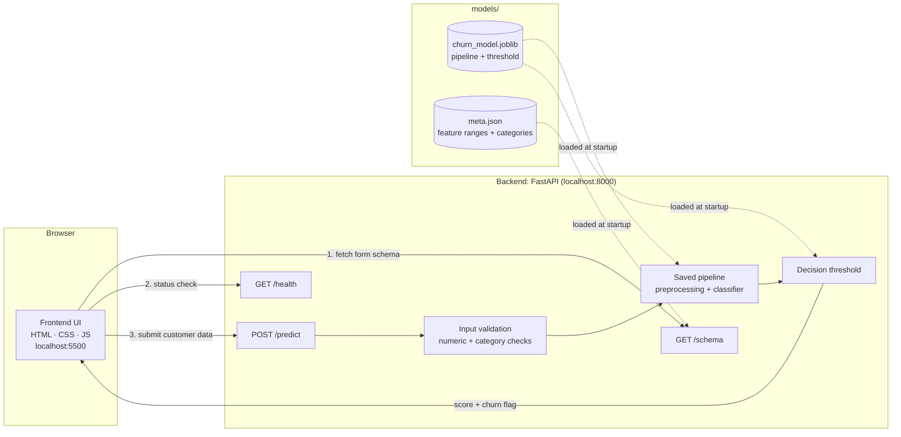
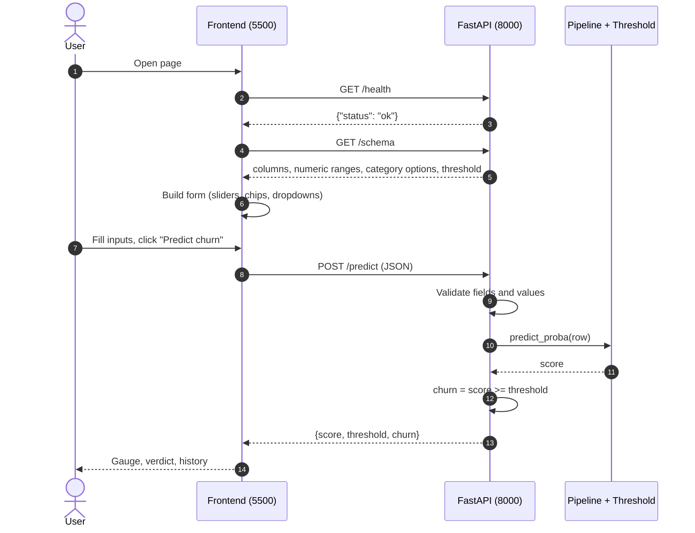
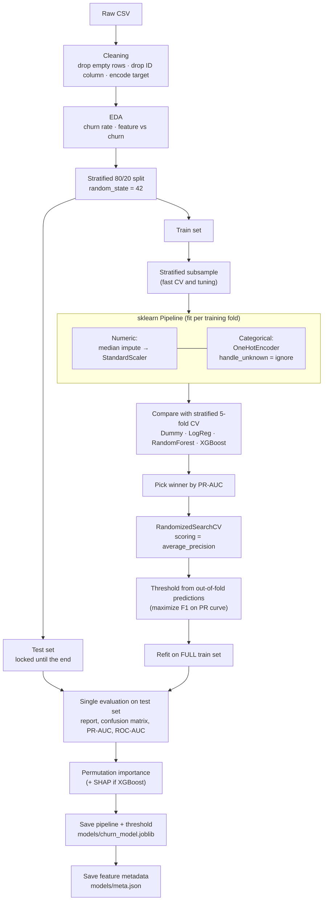
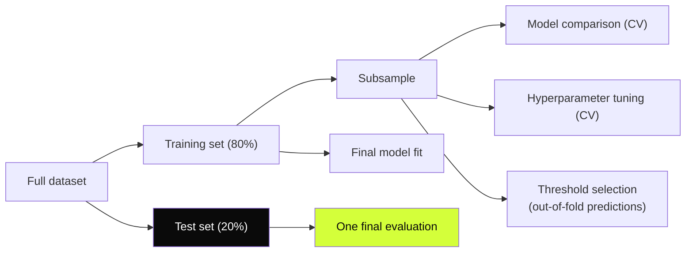

# ChurnSense

**End-to-end customer churn prediction: a leakage-safe scikit-learn pipeline, a FastAPI model service, and a standalone web UI.**


ChurnSense predicts whether a customer is likely to leave. The model is trained in a notebook, saved together with its decision threshold, served through a REST API, and consumed by a separate web interface that builds its own form from the model's schema.

> **Note on results:** every number in this README is filled in from the notebook outputs. Values in `[brackets]` are placeholders until you paste yours in (see [Results](#results)).

---

## Table of contents

1. [Demo](#demo)
2. [Problem statement](#problem-statement)
3. [Key features](#key-features)
4. [System architecture](#system-architecture)
5. [ML pipeline](#ml-pipeline)
6. [Dataset](#dataset)
7. [Methodology](#methodology)
8. [Results](#results)
9. [Model explainability](#model-explainability)
10. [API reference](#api-reference)
11. [Frontend](#frontend)
12. [Project structure](#project-structure)
13. [Getting started](#getting-started)
14. [Design decisions](#design-decisions)
15. [Limitations](#limitations)
16. [Future work](#future-work)
17. [Tech stack](#tech-stack)
18. [Author](#author)

---

## Demo

| Light mode | Dark mode |
|---|---|
|  |  |

| Prediction result | API docs (`/docs`) |
|---|---|
|  |  |

*(Add your screenshots to `docs/screenshots/` using these filenames.)*

---

## Problem statement

Acquiring a new customer typically costs more than retaining an existing one, so businesses want to identify customers at risk of leaving **before** they go.

This is a **binary classification** task:

- **Input:** customer attributes (numeric and categorical)
- **Target:** `Churn` (1 = customer left, 0 = customer stayed)
- **Business framing:** a missed churner (false negative) loses revenue, while a false alarm (false positive) only wastes a retention offer. The two errors do not cost the same, so evaluation focuses on **PR-AUC, recall and precision**, and the decision threshold is tuned instead of defaulting to 0.5.

---

## Key features

- **Leakage-safe preprocessing:** imputation, scaling and one-hot encoding live inside a single scikit-learn `Pipeline`, so they are fit only on training folds.
- **Honest model comparison:** a dummy baseline, Logistic Regression, Random Forest and XGBoost, compared with stratified 5-fold cross-validation.
- **Right metrics for the problem:** PR-AUC, ROC-AUC, F1, recall and precision, not accuracy alone.
- **Threshold tuning without touching the test set:** chosen from out-of-fold predictions.
- **Single-use test set:** evaluated exactly once at the end.
- **Explainability:** permutation importance (and SHAP when XGBoost wins).
- **Decoupled serving:** FastAPI service with input validation and a `/schema` endpoint.
- **Schema-driven UI:** the frontend builds its form from the API, so it stays in sync with the model's features.

---

## System architecture



### Request flow



---

## ML pipeline



### Where each data split is used



The test set is never used for tuning, model selection or threshold choice.

---

## Dataset

| Item | Value |
|---|---|
| Source | Kaggle: Customer Churn Dataset (training file) |
| File used | `customer_churn_dataset-training-master.csv` |
| Rows (after cleaning) | `[N]` |
| Features | `[N]` (numeric: `[N]`, categorical: `[N]`) |
| Target | `Churn` (0 / 1) |
| Churn rate | `[x]%` |

The dataset is **not** committed to this repository. Download it from Kaggle and update the path in the notebook.

---

## Methodology

### 1. Cleaning
- Dropped fully empty rows and rows with a missing target.
- Mapped the target to integer 0/1.
- Dropped the ID column (no predictive meaning, and it invites memorization).
- Checked for duplicate rows.

### 2. Preprocessing (inside the pipeline)

| Feature type | Steps |
|---|---|
| Numeric | Median imputation → `StandardScaler` |
| Categorical | `OneHotEncoder(handle_unknown="ignore")` |

Because these steps live inside the `Pipeline`, cross-validation fits them only on each training fold. Unseen categories at inference do not crash the model.

### 3. Models compared

| Model | Role |
|---|---|
| `DummyClassifier(prior)` | "No skill" reference |
| Logistic Regression | Linear baseline |
| Random Forest | Bagged trees (variance reduction) |
| XGBoost | Gradient boosting (bias reduction) |

Evaluated with stratified 5-fold CV on accuracy, PR-AUC, ROC-AUC, F1, recall and precision. The winner was selected by **PR-AUC**.

### 4. Tuning
`RandomizedSearchCV` on the winning model, scored on PR-AUC, over a small grid.

### 5. Threshold selection
Out-of-fold probabilities on the training subsample feed a precision-recall curve. The threshold maximizing F1 was chosen: **`[threshold]`**. This avoids both the default 0.5 and any use of the test set.

### 6. Final evaluation
The tuned pipeline is refit on the **full** training split and evaluated **once** on the held-out test set.

---

## Results

### Cross-validation comparison (training subsample)

| Model | Accuracy | PR-AUC | ROC-AUC | F1 | Recall | Precision |
|---|---|---|---|---|---|---|
| Dummy (baseline) | `[ ]` | `[ ]` | `[ ]` | `[ ]` | `[ ]` | `[ ]` |
| Logistic Regression | `[ ]` | `[ ]` | `[ ]` | `[ ]` | `[ ]` | `[ ]` |
| Random Forest | `[ ]` | `[ ]` | `[ ]` | `[ ]` | `[ ]` | `[ ]` |
| XGBoost | `[ ]` | `[ ]` | `[ ]` | `[ ]` | `[ ]` | `[ ]` |

**Selected model:** `[model]` with best parameters `[params]`.

### Final test-set performance (evaluated once)

| Metric | Value |
|---|---|
| Decision threshold | `[ ]` |
| Precision | `[ ]` |
| Recall | `[ ]` |
| F1 | `[ ]` |
| PR-AUC | `[ ]` |
| ROC-AUC | `[ ]` |
| Majority-class accuracy (reference) | `[ ]` |

### Confusion matrix (test set)

|  | Predicted: stay | Predicted: churn |
|---|---|---|
| **Actual: stay** | TN = `[ ]` | FP = `[ ]` |
| **Actual: churn** | FN = `[ ]` | TP = `[ ]` |

> **Reading the results honestly:** this dataset may be synthetic or highly separable. Scores on it should be read as "performance on this dataset", not as a prediction of real-world performance. See [Limitations](#limitations).

---

## Model explainability

**Permutation importance** shuffles one feature at a time on a test sample and measures the drop in PR-AUC. A larger drop means the model relies on that feature more. It works on the raw input columns for any model type.

| Rank | Feature | PR-AUC drop |
|---|---|---|
| 1 | `[feature]` | `[ ]` |
| 2 | `[feature]` | `[ ]` |
| 3 | `[feature]` | `[ ]` |


Importance describes what the model *uses*, not what *causes* churn.

---

## API reference

Base URL (local): `http://127.0.0.1:8000`. Interactive docs at `/docs`.

| Method | Endpoint | Purpose |
|---|---|---|
| `GET` | `/health` | Liveness check |
| `GET` | `/schema` | Feature list, numeric ranges, category options, decision threshold |
| `POST` | `/predict` | Score one customer |

### `GET /health`
```json
{ "status": "ok" }
```

### `GET /schema`
```json
{
  "columns": ["<feature_1>", "<feature_2>", "..."],
  "num": { "<numeric_feature>": { "min": 0, "max": 100, "median": 30, "is_int": true } },
  "cat": { "<categorical_feature>": ["option_a", "option_b"] },
  "threshold": 0.5
}
```

### `POST /predict`

Request body: one value for every column returned by `/schema`.
```json
{
  "<numeric_feature>": 30,
  "<categorical_feature>": "option_a"
}
```

Response:
```json
{ "score": 0.78, "threshold": 0.5, "churn": true }
```

`score` is the model's output for the positive class, **not a calibrated probability**. `churn` is `score >= threshold`.

### Validation and errors

| Status | Cause |
|---|---|
| `422` | A required field is missing |
| `422` | A numeric field is not a valid number |
| `422` | A categorical value is not one of the known options |

---

## Frontend

A static single-page interface (no framework, no build step).

- Form generated at runtime from `/schema`: **sliders synced with number boxes** for numeric fields, **clickable chips** for categories with up to 4 options, dropdowns otherwise
- Live **API status** indicator
- Animated **gauge** with the decision threshold marker and a count-up score
- **Reset** and **Randomize** buttons for quick testing
- **Prediction history** (last 6); click an entry to reload its inputs
- **Light and dark** themes with a saved preference
- Responsive layout

---

## Project structure

```
churn-prediction/
├── api.py                    # FastAPI service (health, schema, predict)
├── app.py                    # Optional Streamlit demo
├── start.bat                 # Launches API + frontend on Windows
├── requirements.txt
├── README.md
├── .gitignore
│
├── frontend/
│   ├── index.html
│   ├── style.css
│   └── app.js
│
├── models/                   # created by the notebook
│   ├── churn_model.joblib    # pipeline + threshold
│   └── meta.json             # feature ranges + categories for the UI
│
├── notebooks/
│   └── exploratory_analysis.ipynb
│
├── docs/
│   └── screenshots/
│
├── reports/
└── src/
```

---

## Getting started

### Prerequisites
- Python 3.11
- Git

### 1. Clone and install

```bash
git clone https://github.com/RakeshPranav/ChurnSense.git
cd ChurnSense

python -m venv venv
# Windows (PowerShell)
venv\Scripts\Activate.ps1
# macOS / Linux
source venv/bin/activate

pip install -r requirements.txt
pip install fastapi uvicorn
```

### 2. Get the data
Download the Kaggle churn dataset and update `DATASET_PATH` in the first notebook cell.

### 3. Train the model
Open `notebooks/exploratory_analysis.ipynb` and run **all cells** (Kernel → Restart & Run All). This creates:

- `models/churn_model.joblib`
- `models/meta.json`

### 4. Run the application

**Windows, one click:**
```bat
start.bat
```

**Manual (two terminals):**

```bash
# Terminal 1: API
python -m uvicorn api:app --reload --port 8000
```
```bash
# Terminal 2: frontend
cd frontend
python -m http.server 5500
```

Open **http://localhost:5500**.

| URL | What you get |
|---|---|
| http://localhost:5500 | ChurnSense UI |
| http://127.0.0.1:8000/docs | Interactive API docs |
| http://127.0.0.1:8000/health | `{"status": "ok"}` |

### Optional: Streamlit demo
```bash
python -m streamlit run app.py
```

### Troubleshooting

| Problem | Fix |
|---|---|
| `Could not import module "api"` | Run uvicorn from the folder that contains `api.py` |
| `FileNotFoundError` for model files | Run the notebook's save cells to create `models/` |
| UI shows "API offline" | Start the API and check `/health` |
| CORS error in browser console | Open the UI at exactly `localhost:5500` or `127.0.0.1:5500` |
| Page looks stale | Hard refresh with `Ctrl + F5` |

---

## Design decisions

| Decision | Reason |
|---|---|
| Single sklearn `Pipeline` | Prevents data leakage and keeps preprocessing and model in sync at inference |
| Stratified splits and CV | Keeps class proportions stable across folds |
| PR-AUC as the selection metric | Focuses on the positive (churn) class and is not inflated by true negatives |
| Tuned threshold instead of 0.5 | Missed churners and false alarms have different costs |
| Threshold chosen on out-of-fold predictions | Keeps the test set a clean, one-time estimate |
| Test set touched once | Avoids optimistic evaluation |
| Subsample for CV and tuning, full data for the final fit | Fast iteration on a large dataset without weakening the final model |
| Dummy baseline in the comparison table | Shows what "no skill" scores, so improvement is measurable |
| Pipeline and threshold saved together | The cutoff cannot drift out of sync with the model |
| Backend and frontend separated | Mirrors a real deployment; the model can be reused by any client |
| Form built from `/schema` | The UI automatically matches the model's features |
| Server-side validation | The API never trusts the client |

---

## Limitations

1. **The dataset may be synthetic.** Very high scores can reflect the data's structure rather than real-world performance.
2. Tuning used a **subsample and a small search grid**.
3. **No probability calibration.** The score should not be read as a true churn probability.
4. **No time-based validation**, since the data has no timestamp. Real churn models should be validated on later periods.
5. Permutation importance shows association, **not causation**.
6. The demo API has **no authentication, rate limiting or monitoring**.

---

## Deployment

| Part | Platform |
|---|---|
| Backend (FastAPI + model) | Render web service |
| Frontend (static) | Vercel, root directory `frontend` |

**Live demo:** https://YOUR-PROJECT.vercel.app
**API docs:** https://churnsense-pj86.onrender.com/docs

> The backend runs on a free tier and may take up to a minute to wake up on the first request.

---

## Tech stack

| Layer | Tools |
|---|---|
| Language | Python 3.11 |
| Data | Pandas, NumPy |
| Modeling | scikit-learn, XGBoost |
| Explainability | Permutation importance, SHAP |
| Serving | FastAPI, Uvicorn, joblib |
| Frontend | HTML, CSS, JavaScript |
| Optional demo | Streamlit |
| Tooling | Git, Jupyter |

---

## Author

**Rakesh Pranav K S**
B.Tech, Computer Science & Business Systems, KPR Institute of Engineering and Technology

- GitHub: [@RakeshPranav](https://github.com/RakeshPranav)
- LinkedIn: [rakesh-pranav](https://linkedin.com/in/rakesh-pranav)